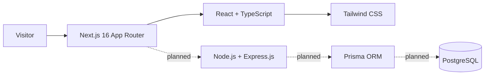

<div align="center">


<h1>TKS Enterprises</h1>

<p><strong>Digital Solutions. Designed for Growth.</strong></p>

<p>A modern digital agency website for clear, thoughtful digital experiences.</p>

<a href="https://github.com/tapish786/tks-enterprises">
  
</a>
<a href="https://github.com/tapish786/tks-enterprises/issues">
  
</a>

<br />

<a href="https://readme-typing-svg.demolab.com/">
  
</a>

<br />

<a href="https://nextjs.org/"></a>
<a href="https://react.dev/"></a>
<a href="https://www.typescriptlang.org/"></a>
<a href="https://tailwindcss.com/"></a>

<br />


<br /><br />

<a href="https://github.com/tapish786/tks-enterprises">Repository</a> ·
<a href="https://github.com/tapish786/tks-enterprises/issues">Issues</a> ·
<a href="LICENSE">MIT License</a>

</div>

<p align="center">━━━━━━━━━━━━━━━━━━━━━━ &nbsp; DIGITAL EXPERIENCES, BUILT WITH INTENTION &nbsp; ━━━━━━━━━━━━━━━━━━━━━━</p>

## About the project

**TKS Enterprises** is a digital agency website built to introduce the agency and present its services, work, and ways to get in touch. The current application is a Next.js frontend. The backend and database are planned; they are not implemented yet.

### Our vision

Help businesses build a strong digital presence through thoughtful design, modern technology, and clear digital strategies.

### Our mission

- Build responsive websites around business needs.
- Present SEO, design, and development services clearly.
- Create user-focused digital experiences.
- Prepare a maintainable foundation for future integrations.

## Services

| Service | Focus |
| --- | --- |
| Web Development | Modern, responsive website experiences |
| SEO | Search optimization for website content and structure |
| UI/UX Design | User-focused interface and experience design |
| Graphic Design | Visual communication and brand design |
| WordPress Development | WordPress website development |
| Website Maintenance | Website care and updates |

These are service descriptions presented by the website, not claims of completed client projects or case studies.

## Website pages and features

| Route | Page |
| --- | --- |
| `/` | Home |
| `/about` | About TKS Enterprises |
| `/services` | Services overview |
| `/services/web-development` | Web Development |
| `/services/seo` | SEO |
| `/services/ui-ux-design` | UI/UX Design |
| `/services/graphic-design` | Graphic Design |
| `/services/wordpress-development` | WordPress Development |
| `/services/website-maintenance` | Website Maintenance |
| `/work` | Work / portfolio page |
| `/blog` | Blog page with sample editorial previews |
| `/contact` | Contact page with client-side form validation |

The contact form is a frontend demo: it validates in the browser and does not send email or save submissions. Blog topics are marked as previews; article pages and publishing integration are not implemented.

## Technology stack

### Implemented frontend

| Technology | Version / role |
| --- | --- |
| [Next.js](https://nextjs.org/) | 16, App Router |
| [React](https://react.dev/) | 19, UI library |
| [TypeScript](https://www.typescriptlang.org/) | 5, typed application code |
| [Tailwind CSS](https://tailwindcss.com/) | 4, styling |
| [ESLint](https://eslint.org/) | Code linting |

### Planned backend

| Technology | Planned role |
| --- | --- |
| Node.js | JavaScript runtime |
| [Express.js](https://expressjs.com/) | Backend application framework |
| [PostgreSQL](https://www.postgresql.org/) | Relational database |
| [Prisma](https://www.prisma.io/) | ORM and database schema tooling |

No backend API, database schema, or Prisma integration is implemented in the current application.

### Development environment

Ubuntu on WSL 2 · Visual Studio Code · Git and GitHub · Codex

## Project architecture



Solid lines show the current frontend. Dashed lines show planned backend work.

## Repository structure

```text
tks-enterprises/
├── LICENSE
├── README.md
└── frontend/
    ├── app/
    │   ├── about/page.tsx
    │   ├── blog/page.tsx
    │   ├── contact/page.tsx
    │   ├── services/
    │   │   ├── graphic-design/page.tsx
    │   │   ├── seo/page.tsx
    │   │   ├── ui-ux-design/page.tsx
    │   │   ├── web-development/page.tsx
    │   │   ├── website-maintenance/page.tsx
    │   │   ├── wordpress-development/page.tsx
    │   │   └── page.tsx
    │   ├── work/page.tsx
    │   ├── globals.css
    │   ├── layout.tsx
    │   └── page.tsx
    ├── components/
    │   ├── home/
    │   │   ├── About.tsx
    │   │   ├── FinalCTA.tsx
    │   │   ├── Hero.tsx
    │   │   ├── Portfolio.tsx
    │   │   ├── Process.tsx
    │   │   ├── Services.tsx
    │   │   ├── TrustSection.tsx
    │   │   └── WhyTKS.tsx
    │   └── layout/
    │       ├── Footer.tsx
    │       └── Header.tsx
    ├── public/
    │   ├── file.svg
    │   ├── globe.svg
    │   ├── next.svg
    │   ├── vercel.svg
    │   └── window.svg
    ├── eslint.config.mjs
    ├── next.config.ts
    ├── package-lock.json
    ├── package.json
    ├── postcss.config.mjs
    └── tsconfig.json
```

## Screenshots and preview

There are no verified project screenshots in the repository yet. No mock or unrelated screenshots are used here. Run the app locally to preview the current interface; real captures can be added when available.

## Getting started

### Prerequisites

- Node.js (LTS recommended)
- npm
- Git

### Install and run the frontend

```bash
git clone https://github.com/tapish786/tks-enterprises.git
cd tks-enterprises/frontend
npm ci
npm run dev
```

Open [http://localhost:3000](http://localhost:3000).

### Useful checks

Run from `frontend/`:

```bash
npm run lint
npx tsc --noEmit
npm run build
```

Run `npm start` after `npm run build` to serve the production build locally.

## Environment variables

The current frontend does not require application environment variables. Backend and database configuration will be documented when those integrations are implemented. Never commit secrets or credentials; document future variable names in an example file with values omitted.

## Git workflow

```text
feature/*  →  develop  →  main
```

| Branch | Purpose |
| --- | --- |
| `main` | Production or stable branch |
| `develop` | Development integration branch |
| `feature/*` | Individual feature work |

Create focused feature branches from `develop`, then open a pull request into `develop`. Promote reviewed, stable work from `develop` to `main` through a pull request. Follow the branch protection and review requirements configured in GitHub.

## Development workflow

1. Update your local `develop` branch.
2. Create a focused branch, such as `feature/contact-page`.
3. Implement and review the change locally.
4. Run relevant lint, type, and build checks.
5. Push the feature branch and open a pull request into `develop`.
6. After integration and review, promote stable changes to `main` through a pull request.

## Current development progress

- Frontend routes for the home, about, services, work, blog, and contact pages are present.
- Individual pages are present for all six listed services.
- The contact form performs client-side validation only; there is no submission integration.
- The blog currently presents sample editorial previews, not published articles.
- Express.js, PostgreSQL, and Prisma work remains planned.
- No verified screenshots are currently included.

## Future roadmap

- Plan and implement the Express.js backend API.
- Add PostgreSQL and Prisma when backend requirements are defined.
- Connect the contact form to an agreed API or email workflow.
- Add database-backed content and a publishing workflow for blog articles.
- Add real project screenshots and case studies when approved project material is available.
- Continue performance, technical SEO, and deployment improvements.

Roadmap items are proposals for future development, not current functionality.

## Contribution guidelines

1. Review existing issues or open one to discuss a significant change.
2. Create a focused `feature/*` branch from `develop`.
3. Keep changes scoped and do not commit secrets or local generated files.
4. Run relevant checks from `frontend/`, including `npm run lint`, `npx tsc --noEmit`, and `npm run build`.
5. Open a pull request into `develop` with a clear summary. Include screenshots for visual changes when useful and follow repository review requirements.

## License

This project is licensed under the [MIT License](LICENSE). Copyright © 2026 Tapish kumar Sharma.

## Contact and project links

For questions or project discussions, use [GitHub Issues](https://github.com/tapish786/tks-enterprises/issues). No public email address, phone number, or office address is listed in the repository.

<div align="center">

<br />

<strong>TKS ENTERPRISES</strong> · Digital Solutions. Designed for Growth.

<br /><br />

<a href="https://github.com/tapish786/tks-enterprises">Repository</a> ·
<a href="https://github.com/tapish786/tks-enterprises/issues">Issues</a> ·
<a href="LICENSE">MIT License</a>

</div>
